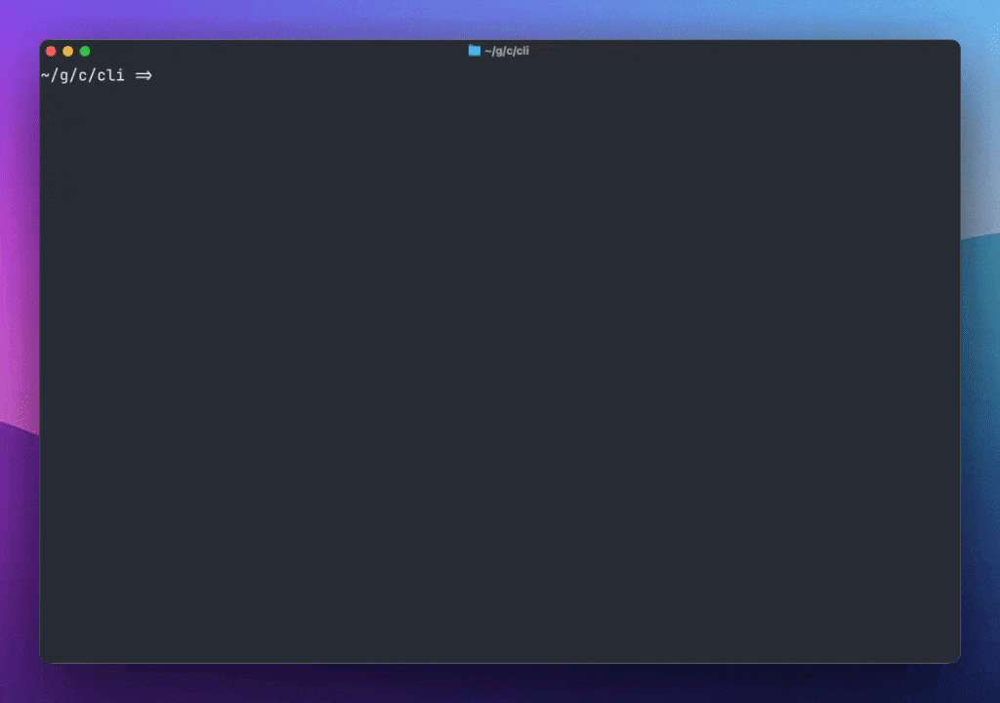

# Continue CLI

Continue CLI (`cn`) は、カスタマイズ可能なコマンドライン型コーディングエージェントです。



## インストール

**macOS / Linux:**

```bash
curl -fsSL https://raw.githubusercontent.com/continuedev/continue/main/extensions/cli/scripts/install.sh | bash
```

**Windows (PowerShell):**

```powershell
irm https://raw.githubusercontent.com/continuedev/continue/main/extensions/cli/scripts/install.ps1 | iex
```

Node.js 20以上がインストールされている場合は、npmでもインストール可能です：

```bash
npm i -g @continuedev/cli
```

## 使い方

```bash
cn
```

### ヘッドレスモード

ヘッドレスモード (`-p` フラグ) は対話型のターミナルUIなしで動作するため、以下に最適です：

- スクリプトや自動化
- CI/CD パイプライン
- Docker コンテナ
- VSCode/IntelliJ 拡張機能との統合
- TTYのない環境

```bash
# 基本的な使用法
cn -p "現在のgitの変更内容に基づいたconventional commit名を生成してください。"

# パイプ入力の使用
echo "このコードをレビューして" | cn -p

# スクリプト用のJSON出力
cn -p "コードを分析して" --format json

# サイレントモード (思考タグを除去)
cn -p "READMEを書いて" --silent
```

**TTYのない環境**: ヘッドレスモードは、VSCode/IntelliJ拡張機能からターミナルコマンドを通じて呼び出される場合など、ターミナル (TTY) がない環境で動作するように設計されています。プロンプトが提供された状態でヘッドレスモードで実行される際、CLIは stdin の読み取りや対話型UIの初期化を試みません。

### セッション管理

CLIは各ターミナルセッションのチャット履歴を自動的に保存します。中断した箇所から再開できます：

```bash
# このターミナルの前回のセッションを再開する
cn --resume

# 最近のセッションを一覧表示して、再開するものを選択する
cn ls

# セッションをJSON形式で一覧表示する (スクリプト用)
cn ls --json
```

## コマンドラインオプション

- `-p`: ヘッドレスモード (TUIなし) で実行
- `--config <path>`: エージェント設定ファイルのパスを指定
- `--resume`: このターミナルの前回のセッションを再開
- `<prompt>`: 開始時に使用するオプションのプロンプト

## 環境変数

- `CONTINUE_CLI_DISABLE_COMMIT_SIGNATURE`: 生成されたコミットメッセージにContinueのコミット署名を追加する機能を無効化します
- `FORCE_NO_TTY`: TTYなしモードを強制し、stdinの読み取りを防止します (テストや自動化に有用)

## コマンド

- `cn`: インタラクティブなチャットセッションを開始
- `cn ls`: 最近のセッションを一覧表示し、TUIセレクターで再開するセッションを選択
- `cn login`: Continueに認証
- `cn logout`: 現在のセッションからログアウト
- `cn remote`: リモートインスタンスを起動
- `cn serve`: HTTPサーバーモードを開始

### セッション一覧 (`cn ls`)

最近のセッションを表示します。ターミナルに収まるよう、画面の高さによって制限されます。

- `--json`: スクリプト用にJSON形式で出力 (常に10件表示)

## TTYレス・サポート

CLIは TTY (ターミナル) がない環境での実行を全面的にサポートしています：

```bash
# TTY割り当てなしのDockerから
docker run --rm my-image cn -p "ドキュメントを生成して"

# CI/CD パイプラインから
cn -p "変更をレビューして" --format json

# VSCode/IntelliJ 拡張機能のターミナルツールから
cn -p "コードを分析して" --silent
```

CLIはTTYがない環境を自動的に検出し、動作を調整します：

- プロンプトが提供されている場合、stdinの読み取りをスキップします
- インタラクティブなUIコンポーネントを無効化します
- きれいな stdout/stderr 出力を保証します

詳細については、[`spec/tty-less-support.md`](./spec/tty-less-support.md) を参照してください。
